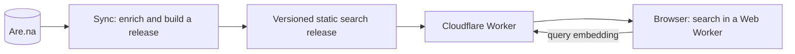

# Archivist

A gallery and search engine for an [Are.na](https://www.are.na) archive. Live at
[archivist.yusufparak.com](https://archivist.yusufparak.com).

Most images saved to Are.na have a filename for a title and no description, so text search cannot
find them. Archivist makes a personal archive of a few thousand blocks findable: by what an image
shows, by what a phrase means, by colour, by when it was saved and by how often it was connected. It
is built for one maintainer's archive, and needs only a few settings changed to run on another (see
[Running your own](#running-your-own)).

- **Hybrid search.** "Exact words" (keyword), "Related ideas" (semantic) and "Best match" (both,
  fused with reciprocal rank fusion).
- **Filters and orders.** Channel, block type, colour, connected and created dates; browse by your
  most or least connected, newest or oldest, or by total connections across Are.na.
- **Images become searchable.** At sync time a vision model describes each image and animation, and
  that description, OCR text and tags are indexed. Colour is measured from the pixels.
- **No generative AI at query time.** Results are always the original Are.na blocks. The only
  per-query server work is embedding the query text.
- **Cheap to host.** Search runs entirely in the visitor's browser over static files, designed to fit
  within Cloudflare's free allocations.

## How it works



1. **Sync.** A sync reads every public channel the account owns, normalizes and deduplicates the
   blocks, and enriches them: colour weights from the pixels (ffmpeg), connection counts from Are.na,
   and vision descriptions from a model on OpenRouter. Enrichment results live in committed JSONL
   caches, so only new or changed blocks cost anything. Generated titles and descriptions can be
   written back to the owner's own blocks.
2. **Release.** The sync builds a content-hashed release: block metadata, a serialized
   [MiniSearch](https://github.com/lucaong/minisearch) index, sentence embeddings of every block from
   Workers AI (`bge-small-en-v1.5`), and a first page for the prerendered gallery.
3. **Search.** The SvelteKit site serves the release as static assets. A Web Worker in the browser
   downloads and verifies it, filters the corpus, ranks it lexically and by exact cosine similarity,
   and fuses the two lists. The Worker's only API is a rate-limited endpoint that embeds the query.
4. **Maintenance.** A [Trigger.dev](https://trigger.dev) job runs the sync every morning, validates the
   new release against a fixture of known searches, and deploys it through GitHub Actions only if
   nothing regresses. State lives in a private Cloudflare R2 bucket.

[docs/architecture.md](./docs/architecture.md) covers each of these in detail.

**Stack:** SvelteKit and Svelte 5, TypeScript, Tailwind CSS 4, Cloudflare Workers and Workers AI,
MiniSearch, Zod, Trigger.dev, Cloudflare R2, Bun and Vitest.

## Getting started

You need [Bun](https://bun.sh), an Are.na access token, and a Cloudflare account with a Workers AI
API token. A sync also needs `ffmpeg` on your `PATH`.

```sh
bun install
cp .env.example .env   # then fill in the variables below
bun run export:search  # build a local search release from the committed caches
bun run dev
```

| Variable                                        | Needed for                                                                     |
| ----------------------------------------------- | ------------------------------------------------------------------------------ |
| `ARENA_ACCESS_TOKEN`                            | Reading the archive (and write-back, which needs write scope)                  |
| `CLOUDFLARE_ACCOUNT_ID`, `CLOUDFLARE_API_TOKEN` | Workers AI embeddings for releases and for queries during `bun run dev`        |
| `ARENA_IGNORE_CHANNELS`                         | Optional comma-separated channel slugs to leave out (private ones always are)  |
| `OPENROUTER_API_KEY`                            | The vision stage of a sync                                                     |
| `TRIGGER_SECRET_KEY`, `MAINTENANCE_R2_*`        | Hosted maintenance                                                             |
| `CLOUDFLARE_DEPLOY_API_TOKEN`                   | Optional deploy token for `bun run hosted deploy` (otherwise `wrangler login`) |
| `GITHUB_DEPLOY_TOKEN`                           | Trigger.dev production only: dispatching the site deploy                       |

`bun run export:search` never generates vision text or writes to Are.na. The search assets it writes
to `static/search/` and the embedding cache in `.search-cache/` are ignored by Git.

## Commands

| Command                                    | What it does                                                                                     |
| ------------------------------------------ | ------------------------------------------------------------------------------------------------ |
| `bun run dev`                              | Start the dev server                                                                             |
| `bun run check` / `lint` / `test`          | Type-check, lint (Prettier, ESLint, canonical Tailwind classes) and run the unit tests           |
| `bun run build`                            | Build the site; needs a release in `static/search/`                                              |
| `bun run deploy`                           | Build and deploy the Worker and assets with Wrangler                                             |
| `bun run export:search`                    | Publish a local release from the committed caches                                                |
| `bun run sync --no-vision --no-push-arena` | Refresh the colour and connection caches, then publish a local release                           |
| `bun run sync`                             | Also generate vision descriptions (spends OpenRouter credit) and write them back to Are.na       |
| `bun run calibrate:colour`                 | Write a contact sheet of colour measurements for tuning thresholds (read-only)                   |
| `bun run hosted <command>`                 | Drive hosted maintenance: sync, retry, deploy, coverage, vision backfills and search experiments |

The `hosted` commands are described in
[docs/architecture.md](./docs/architecture.md#maintainer-cli).

## Running your own

Point `.env` at your own Are.na account, then change the settings that name this deployment:

- `wrangler.jsonc`: `account_id` and the custom domain route.
- `trigger.config.ts`: the Trigger.dev project; `src/trigger/hosted.ts`: `SITE_URL`;
  `src/trigger/daily.ts`: `GITHUB_REPOSITORY` and the daily vision cap.
- `src/lib/components/filters.ts`: the first months of the date sliders.
- `scripts/fixtures/search-cases.json`: the known searches a release must pass. They name blocks in
  this archive, so replace them with your own (at least ten).
- The committed `*-cache.jsonl` files under `src/lib/server/indexing/` describe this archive; delete
  their contents to start fresh.

Hosted maintenance is optional: `bun run sync` and `bun run deploy` work on their own.

## Documentation

- [Architecture](./docs/architecture.md): layout, query path, releases, enrichment, hosted maintenance
- [Design](./docs/design.md): the visual system
- [Decisions](./docs/decisions/): architecture decision records
- [Svelte guidelines](./docs/svelte-guidelines.md) and [AGENTS.md](./AGENTS.md): conventions for
  contributors, human or agent
- [Changelog](./docs/CHANGELOG.md)

The design is modelled on Seth Thompson's [Library](https://library.seththompson.com/).

## License

[MIT](./LICENSE)
