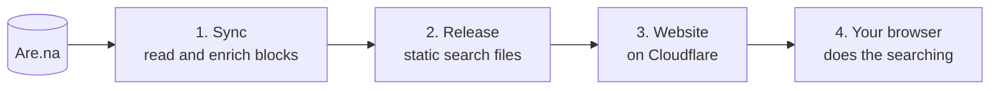

# Archivist

Archivist is a website that lets you **browse and search your [Are.na](https://www.are.na) archive**.
It works even when your saved images have no useful titles or descriptions.

Live example: [archivist.yusufparak.com](https://archivist.yusufparak.com)

## The problem it solves

Are.na is a place to save things you find: images, links, text, videos. The trouble starts when you
have thousands of saved items. Most images have a file name like `IMG_2041.jpg` as their title and no
description. Normal text search cannot find them, because there is no text to match.

Archivist fixes this by using an AI vision model to describe blocks, and provides a search engine to find blocks based on that description. For instance, you can find a block by:

- **What an image shows.** Search "red chair in an empty room" and get that picture, even if its title is `IMG_2041.jpg`.
- **What a phrase means.** Search "feeling nostalgic" and get related blocks, even if they never use those words.
- **Colour.** Pick a colour and see blocks that contain it.
- **Dates.** Filter by when you saved a block.
- **Connections.** Sort by how many channels a block is connected to, on your account or across all of Are.na.

It also has plain keyword search, channel filters and block type filters (image, text, link, and so on).

## Why you might care

You may find this repo useful if you:

- Have a big Are.na archive and want to actually find things in it.
- Want to see a real example of **search that runs entirely in the browser**, with no search server.
- Want to learn how **hybrid search** works: keyword search plus meaning-based search, mixed together.

## Things to know first

- **It is built for one person's archive.** You can run it for your own, but you need to change a few
  settings first. See [Run it for your own archive](#run-it-for-your-own-archive).
- **Results are always your real Are.na blocks.** Nothing is invented. AI is used in two places only:
  to describe images when you sync, and to turn the words you type into numbers (more on that below).
- **Private channels are never read.** Public channels only.
- **It is not made by or connected to Are.na.** It uses the public [Are.na API](https://dev.are.na).
  You are responsible for following Are.na's terms, and for having the right to show anything you
  publish, including blocks that other people made.

## How it works

The idea in one sentence: **do the slow, expensive work once, ahead of time. Then search is just
reading files.**



**1. Sync.** A script reads all your public channels and then adds extra information to each block:

- **Colour.** It measures the colours in each image (using `ffmpeg`).
- **Connections.** It asks Are.na how many channels each block belongs to.
- **Descriptions (optional).** A vision AI model, through [OpenRouter](https://openrouter.ai), looks at each image
  and writes a description, picks out any text in it (OCR) and adds tags. This is what makes
  "red chair in an empty room" work.

The results are saved in local cache files in `data/`. A block is only processed once, so later syncs are fast and cheap.

**2. Release.** The script packs everything into a **release**: a folder of static files
containing your block data, a keyword search index (built with [MiniSearch](https://github.com/lucaong/minisearch)),
and an **embedding** for every block. An embedding is a list of numbers that captures the meaning of
some text. Blocks with similar meanings get similar numbers. The embeddings come from Cloudflare Workers AI.

**3. Website.** A SvelteKit app, running on a Cloudflare Worker, serves the release files like any
other static files.

**4. Search in the browser.** When you open the site, a Web Worker (a background thread in your
browser) downloads the release and checks it is intact. When you search, it:

1. Applies your filters (channel, colour, dates, type).
2. Ranks blocks by **keywords** (Exact words).
3. Ranks blocks by **meaning** (Related ideas). To do this it compares your query's embedding with every block's embedding.
4. Merges the two lists with a method called [reciprocal rank fusion](https://en.wikipedia.org/wiki/Mean_reciprocal_rank) (Best match).

The server does only one thing at search time: it turns your query text into an embedding. It
cannot do that in the browser, so it has a small, rate-limited endpoint for it (60 requests a minute per visitor).

**5. Daily upkeep (optional).** A [Trigger.dev](https://trigger.dev) job runs the sync every morning.
It tests the new release against a list of known searches. If any search got worse, it does **not** deploy. Otherwise it deploys through GitHub Actions.

Want more detail? Read [docs/architecture.md](./docs/architecture.md).

## Tech stack

| What                  | Used for                                          |
| --------------------- | ------------------------------------------------- |
| SvelteKit + Svelte 5  | The website                                       |
| TypeScript, Zod       | Typed code, and checking data from outside        |
| Tailwind CSS 4        | Styling                                           |
| Cloudflare Workers    | Hosting the site and the one small API            |
| Cloudflare Workers AI | Turning text into embeddings                      |
| Cloudflare R2         | Private storage for the daily job's state         |
| MiniSearch            | Keyword search in the browser                     |
| OpenRouter            | The vision model that describes images (optional) |
| Trigger.dev           | The daily sync job (optional)                     |
| Bun, Vitest           | Running scripts, and tests                        |

## Quick start

### What you need

- [Bun](https://bun.sh) (the JavaScript runtime and package manager used here)
- [`ffmpeg`](https://ffmpeg.org) installed and on your `PATH`. It measures colour.
- An [Are.na access token](https://dev.are.na)
- A Cloudflare account, with a Workers AI API token and your account ID

You do **not** need OpenRouter, Trigger.dev or R2 to get a working local gallery.

### Steps

```sh
bun install
cp .env.example .env     # then open .env and fill in the three values below
bun run sync             # reads your public channels and builds a local search release
bun run dev              # starts the site on your machine
```

The three values to fill in:

```sh
ARENA_ACCESS_TOKEN=...
CLOUDFLARE_ACCOUNT_ID=...
CLOUDFLARE_API_TOKEN=...
```

A plain `bun run sync` is safe. It only **reads** from Are.na. It never spends OpenRouter credit and never changes your blocks. Both of those are opt-in (see below).

The files it creates (`static/search/`, `data/`, `.search-cache/`) are ignored by Git.

> **Tip:** to leave out some public channels, put their slugs in `ARENA_IGNORE_CHANNELS`, separated by commas.

## Environment variables

| Variable                                        | What it is for                                                             |
| ----------------------------------------------- | -------------------------------------------------------------------------- |
| `ARENA_ACCESS_TOKEN`                            | Reading your archive. Needs write access only for `--push-arena`.          |
| `CLOUDFLARE_ACCOUNT_ID`, `CLOUDFLARE_API_TOKEN` | Embeddings, when building a release and when running `bun run dev`         |
| `ARENA_IGNORE_CHANNELS`                         | Optional. Public channels to skip.                                         |
| `OPENROUTER_API_KEY`                            | Only for `bun run sync --vision`                                           |
| `TRIGGER_SECRET_KEY`, `MAINTENANCE_R2_*`        | Only for the daily hosted job                                              |
| `CLOUDFLARE_DEPLOY_API_TOKEN`                   | Optional. Used by `bun run hosted deploy`. Otherwise use `wrangler login`. |
| `GITHUB_DEPLOY_TOKEN`                           | Only in Trigger.dev production, to start the site deploy                   |

Never commit your `.env` file. It is already in `.gitignore`.

## Commands

| Command                     | What it does                                                                       |
| --------------------------- | ---------------------------------------------------------------------------------- |
| `bun run dev`               | Start the dev server                                                               |
| `bun run sync`              | Read your archive, measure colour and connections, build a local release           |
| `bun run sync --export`     | Build a release from existing caches only. Measures nothing new.                   |
| `bun run sync --vision`     | Also describe new images with the vision model. **Spends OpenRouter credit.**      |
| `bun run sync --push-arena` | Also write generated titles and descriptions to your own blocks. **Edits Are.na.** |
| `bun run check`             | Type-check the project                                                             |
| `bun run lint`              | Check formatting and code style                                                    |
| `bun run format`            | Fix formatting automatically                                                       |
| `bun run test`              | Run the unit tests                                                                 |
| `bun run build`             | Build the site (needs a release in `static/search/`)                               |
| `bun run preview`           | Preview the production build locally                                               |
| `bun run deploy`            | Build and deploy to Cloudflare with Wrangler                                       |
| `bun run hosted <command>`  | Run the hosted maintenance tools (sync, retry, deploy, backfills)                  |

> **Careful with `--push-arena`.** It changes your real Are.na blocks, and you cannot undo it. It
> only touches blocks you own. It only fills in a _missing_ description, and only replaces a title
> that says nothing useful (like a file name). Try it on a small channel first.

## Project layout

```text
src/
  routes/        Pages and the one API endpoint. Wiring only, no logic.
  lib/
    components/  Svelte UI components
    domain/      Shared types and the search URL rules
    search/      Ranking: keyword, meaning, and merging the two (runs in the browser)
    server/      Are.na, OpenRouter and Workers AI code, plus indexing and maintenance
scripts/         Command-line tools (sync, hosted maintenance) and test fixtures
docs/            Architecture notes and decision records
static/search/   The generated search release (not committed)
data/            Local caches (not committed)
```

## Run it for your own archive

For a local gallery, putting your own tokens in `.env` and running `bun run sync` is enough.

To **deploy** your own copy, change the files that name this deployment:

| File                                 | What to change                                                                           |
| ------------------------------------ | ---------------------------------------------------------------------------------------- |
| `wrangler.jsonc`                     | `account_id` and the custom domain (or remove the route and set `workers_dev` to `true`) |
| `site.config.ts`                     | Site URL, GitHub repo, Trigger.dev project, daily vision limit                           |
| `src/lib/components/filters.ts`      | The start of the date sliders (the oldest block and connection in your archive)          |
| `scripts/fixtures/search-cases.json` | The known searches a release must pass (only needed for the daily job)                   |

The search cases in that last file point at blocks in the maintainer's archive. Replace them with at least ten searches of your own, each with the block IDs it should return.

If you deploy from GitHub Actions, add these repository secrets: `CLOUDFLARE_ACCOUNT_ID`,
`CLOUDFLARE_DEPLOY_API_TOKEN` and the `MAINTENANCE_R2_*` values. For the daily job, also add `TRIGGER_ACCESS_TOKEN`.

**A note on cost.** Every search turns the query into an embedding, and Workers AI bills per request.
Set a spend alert on your Cloudflare account, to be safe.

## Learn more

- [Architecture](./docs/architecture.md): how every part works in detail
- [Decision records](./docs/decisions/): why important choices were made
- [Svelte guidelines](./docs/svelte-guidelines.md) and [AGENTS.md](./AGENTS.md): the rules for people and AI agents who change this code
- [Changelog](./docs/CHANGELOG.md): what changed and when

## License

[MIT](./LICENSE)
