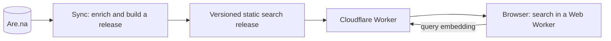

# Archivist

A gallery and search engine for an [Are.na](https://www.are.na) archive. Live at
[archivist.yusufparak.com](https://archivist.yusufparak.com).

Most images saved to Are.na have a filename for a title and no description, so text search cannot
find them. Archivist makes a personal archive of a few thousand blocks findable: by what an image
shows, by what a phrase means, by colour, by when it was saved and by how often it was connected. It
is built for one maintainer's archive, and needs only a few settings changed to run on another (see
[Running your own](#running-your-own)).

- **Hybrid search.** "Exact words" (keyword), "Related ideas" (semantic) and "Best match" (both,
  fused with reciprocal rank fusion).
- **Filters and orders.** Channel, block type, colour, connected and created dates; browse by your
  most or least connected, newest or oldest, or by total connections across Are.na.
- **Images become searchable.** At sync time a vision model describes each image and animation, and
  that description, OCR text and tags are indexed. Colour is measured from the pixels.
- **No generative AI at query time.** Results are always the original Are.na blocks. The only
  per-query server work is embedding the query text.
- **Cheap to host.** Search runs entirely in the visitor's browser over static files, designed to fit
  within Cloudflare's free allocations.

Archivist is an independent project and is not affiliated with or endorsed by Are.na. It reads
channels through the [Are.na API](https://dev.are.na); you are responsible for following Are.na's
terms and for the rights to whatever your gallery republishes, including blocks other people made.

## How it works



1. **Sync.** A sync reads every public channel the account owns, normalizes and deduplicates the
   blocks, and enriches them: colour weights from the pixels (ffmpeg), connection counts from Are.na,
   and vision descriptions from a model on OpenRouter. Enrichment results live in local JSONL
   caches (`data/`, not committed), so only new or changed blocks cost anything. Generated titles and descriptions can be
   written back to the owner's own blocks.
2. **Release.** The sync builds a content-hashed release: block metadata, a serialized
   [MiniSearch](https://github.com/lucaong/minisearch) index, sentence embeddings of every block from
   Workers AI (`bge-small-en-v1.5`), and a first page for the prerendered gallery.
3. **Search.** The SvelteKit site serves the release as static assets. A Web Worker in the browser
   downloads and verifies it, filters the corpus, ranks it lexically and by exact cosine similarity,
   and fuses the two lists. The Worker's only API is a rate-limited endpoint that embeds the query.
4. **Maintenance.** A [Trigger.dev](https://trigger.dev) job runs the sync every morning, validates the
   new release against a fixture of known searches, and deploys it through GitHub Actions only if
   nothing regresses. State lives in a private Cloudflare R2 bucket.

[docs/architecture.md](./docs/architecture.md) covers each of these in detail.

**Stack:** SvelteKit and Svelte 5, TypeScript, Tailwind CSS 4, Cloudflare Workers and Workers AI,
MiniSearch, Zod, Trigger.dev, Cloudflare R2, Bun and Vitest.

## Getting started

You need [Bun](https://bun.sh), `ffmpeg` on your `PATH` (colour measurement), an
[Are.na access token](https://dev.are.na) and a Cloudflare account with a Workers
AI API token. Nothing else is required: hosted maintenance, vision and write-back are all optional.

```sh
bun install
cp .env.example .env   # fill in ARENA_ACCESS_TOKEN, CLOUDFLARE_ACCOUNT_ID and CLOUDFLARE_API_TOKEN
bun run sync           # read your public channels, measure colour, build a local search release
bun run dev
```

A plain `bun run sync` only reads from Are.na. It never spends OpenRouter credit and never edits your
blocks; both are opt-in flags, described under [Commands](#commands). Private channels are always
skipped, and `ARENA_IGNORE_CHANNELS` leaves out public ones you would rather not index. The search
assets it writes to `static/search/` and the caches in `data/` and `.search-cache/` are ignored by Git.

| Variable                                        | Needed for                                                                     |
| ----------------------------------------------- | ------------------------------------------------------------------------------ |
| `ARENA_ACCESS_TOKEN`                            | Reading the archive (`--push-arena` write-back also needs write scope)         |
| `CLOUDFLARE_ACCOUNT_ID`, `CLOUDFLARE_API_TOKEN` | Workers AI embeddings for releases and for queries during `bun run dev`        |
| `ARENA_IGNORE_CHANNELS`                         | Optional comma-separated channel slugs to leave out (private ones always are)  |
| `OPENROUTER_API_KEY`                            | `bun run sync --vision`                                                        |
| `TRIGGER_SECRET_KEY`, `MAINTENANCE_R2_*`        | Hosted maintenance                                                             |
| `CLOUDFLARE_DEPLOY_API_TOKEN`                   | Optional deploy token for `bun run hosted deploy` (otherwise `wrangler login`) |
| `GITHUB_DEPLOY_TOKEN`                           | Trigger.dev production only: dispatching the site deploy                       |

## Commands

| Command                           | What it does                                                                            |
| --------------------------------- | --------------------------------------------------------------------------------------- |
| `bun run dev`                     | Start the dev server                                                                    |
| `bun run check` / `lint` / `test` | Type-check, lint (Prettier, ESLint, canonical Tailwind classes) and run the unit tests  |
| `bun run build`                   | Build the site; needs a release in `static/search/`                                     |
| `bun run deploy`                  | Build and deploy the Worker and assets with Wrangler                                    |
| `bun run sync`                    | Read your archive, refresh the colour and connection caches and publish a local release |
| `bun run sync --export`           | Publish a local release from the existing caches without measuring anything             |
| `bun run sync --vision`           | Also describe new images with a vision model (spends OpenRouter credit)                 |
| `bun run sync --push-arena`       | Also write generated titles and descriptions to your own blocks that have none          |
| `bun run hosted <command>`        | Drive hosted maintenance: sync, retry, deploy, coverage and vision backfills            |

`--push-arena` edits your Are.na blocks. It only touches blocks you own, only fills a missing
description and only replaces a title that carries no information, but it cannot be undone, so try it
on a small channel first (`ARENA_IGNORE_CHANNELS` can exclude the rest).

The `hosted` commands are described in
[docs/architecture.md](./docs/architecture.md#maintainer-cli).

## Running your own

Point `.env` at your own Are.na account and run `bun run sync`; that is enough for a local gallery.
To deploy it, change the files that name this deployment:

| File                                 | What to change                                                                               |
| ------------------------------------ | -------------------------------------------------------------------------------------------- |
| `wrangler.jsonc`                     | `account_id` and the custom domain route (or drop the route and set `workers_dev` to `true`) |
| `site.config.ts`                     | Site URL, GitHub repository, Trigger.dev project and the daily vision ceiling                |
| `src/lib/components/filters.ts`      | The first months of the date sliders (the oldest block and connection in your archive)       |
| `scripts/fixtures/search-cases.json` | Known searches a hosted release must pass (see below)                                        |

Hosted maintenance (the daily Trigger.dev job) is optional, and only it needs the fixture. Its cases
name blocks in this maintainer's archive, so replace them with your own: at least ten searches, each
with the block IDs it should return, in the shape the existing file shows.

Deploying from CI needs these repository secrets: `TRIGGER_ACCESS_TOKEN` for the Trigger.dev deploy
(forks without it skip that job), and `CLOUDFLARE_ACCOUNT_ID`, `CLOUDFLARE_DEPLOY_API_TOKEN` and the
`MAINTENANCE_R2_*` values for the site deploy. Workers AI is billed per query embedding, so set a spend
alert on your Cloudflare account; the endpoint is rate limited to 60 requests a minute per client.

## Documentation

- [Architecture](./docs/architecture.md): layout, query path, releases, enrichment, hosted maintenance
- [Decisions](./docs/decisions/): architecture decision records
- [Svelte guidelines](./docs/svelte-guidelines.md) and [AGENTS.md](./AGENTS.md): conventions for
  contributors, human or agent
- [Changelog](./docs/CHANGELOG.md)

## Credits

The design is modelled on Seth Thompson's [Library](https://library.seththompson.com/). Text is set
in Newsreader, licensed under the [SIL Open Font License](https://openfontlicense.org/).

## Contributing

Issues and pull requests are welcome; see [CONTRIBUTING.md](./CONTRIBUTING.md). Report security
problems privately as described in [SECURITY.md](./SECURITY.md).

## License

[MIT](./LICENSE)
