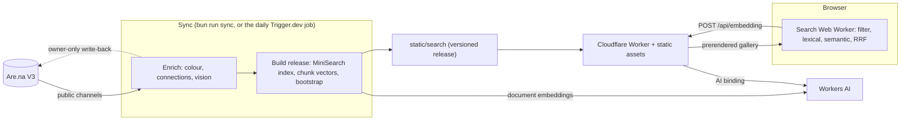

# Architecture

Archivist is a SvelteKit app on Cloudflare Workers. Are.na V3 is the source of truth. A sync turns
the archive into a public, content-hashed **search release** (static files), and visitors search
that release in their own browser. The only server work at query time is embedding the query text.

## Repository layout

| Path                           | Responsibility                                                                                                                                                                                                                                                       |
| ------------------------------ | -------------------------------------------------------------------------------------------------------------------------------------------------------------------------------------------------------------------------------------------------------------------- |
| `src/lib/domain/`              | Framework-free types and transformations. `search.ts` owns the URL grammar and ships to the browser, so it has no runtime validation library; `archive.ts` builds `SearchDocument`s with Zod and is server-only; `titles.ts` spots titles that carry no information. |
| `src/lib/search/`              | Client-safe search: request validation, snapshot schemas, ranking and RRF, colour thresholds, and the browser Web Worker and its client.                                                                                                                             |
| `src/lib/components/`          | Presentation components and their pure helpers. Never import `src/lib/server/**`.                                                                                                                                                                                    |
| `src/routes/`                  | HTTP and UI composition: the prerendered gallery, `/api/embedding` and the retired `/api/search`.                                                                                                                                                                    |
| `src/lib/server/arena/`        | Are.na transport, payload schemas and pagination.                                                                                                                                                                                                                    |
| `src/lib/server/indexing/`     | Normalization, channel filtering, sync orchestration, the colour, connections and vision stages, CLI progress, and the three committed caches (`*-cache.jsonl`).                                                                                                     |
| `src/lib/server/search/`       | Release building, public document export, the Workers AI embedder, query embedding handling and the evaluation fixture schema.                                                                                                                                       |
| `src/lib/server/maintenance/`  | Node-only hosted maintenance: candidate validation, the R2 store, the archive lease, hosted caches, sync, backfills, experiments and deployment staging. Never imported by Worker routes.                                                                            |
| `src/lib/server/rate-limit.ts` | Edge rate limiting, wired in through `src/hooks.server.ts`.                                                                                                                                                                                                          |
| `src/styles/`                  | Fonts, Tailwind theme tokens and semantic colour roles.                                                                                                                                                                                      |
| `src/trigger/`                 | Trigger.dev task entrypoints. `source-identity.ts` is overwritten by CI.                                                                                                                                                                                             |
| `scripts/`                     | Maintainer CLIs, the search evaluation fixture, the CI fixture builder and `worktree.sh`. Type-checked separately because they need Node globals.                                                                                                                    |

## Query path

The default gallery is prerendered from the release's bootstrap file. After mount, the URL drives
browser search and paging; interactive search and filtering require JavaScript. Public requests never
reach Are.na. `/api/embedding` accepts at most 400 characters (a 4,096-byte JSON body) and returns a
versioned, normalized Workers AI vector. `/api/search` is retired and returns 410. Both share one
per-client rate limiter; embeddings fail closed when it is unavailable.

The search Worker downloads and verifies the release's assets lazily: metadata first, the lexical
index for keyword modes, the vector shards for semantic modes. Every asset is checked against its
declared size and SHA-256.

### Retrieval

Canonical `search_text` is assembled by `toSearchDocument` in `src/lib/domain/archive.ts`, in this
order: block title, description, content, source title (a title or source title that `titles.ts`
classes as an upload filename or opaque token is omitted), deduplicated channel titles, cached vision
description, bounded OCR, and normalized tags joined with commas. Each field has whitespace
collapsed, empty fields are omitted, and fields are joined with newlines. Generated vision titles,
medium and palette are not part of this text. Tags are lowercased, dehyphenated, deduplicated and
sorted; OCR is capped at 6,000 characters and discarded when its bounded sample has at least 100
words but fewer than 10% unique words.

- **Filter first.** The complete corpus is filtered before ranking: block type and channel are ORed,
  colours ANDed, dates compared in UTC.
- **Lexical.** MiniSearch with prefix matching, so "widget" finds "widgets".
- **Semantic.** Exact cosine similarity over every eligible chunk vector, taking the maximum score
  per block.
- **Hybrid.** Reciprocal rank fusion of the complete lexical and semantic lists (`k = 60`).
- **Ties and paging.** Ties break on block ID, and paging walks the full ranking.

Results are always the original Are.na blocks; nothing generated is ever presented as a result.

## Releases

Discovery is public-only: private channels are always skipped, and `ARENA_IGNORE_CHANNELS` skips
others. Incomplete or empty discovery cannot produce a release.

A release holds checked metadata (result fields, filter and sort data, vector-to-block mapping), a
serialized MiniSearch index, Float32 vector shards and a first-page bootstrap. Each asset is capped
at 25 MiB and vector shards at about 8 MiB. Generated vision fields are absent from the result shape,
but their indexed text is downloadable in the lexical asset. Incompatible snapshot or embedding
changes require a new version.

Document embeddings use `@cf/baai/bge-small-en-v1.5` (384 dimensions) over chunks of at most 384
UTF-8 bytes that together cover the complete canonical text. The builder embeds missing unique
chunks in batches of 32 and caches them by embedding version and text hash. Query embeddings use the
same model with the configured query prefix.

`scripts/search-files.ts` stages each release in an immutable `static/search/releases/<version>/`
directory, then atomically replaces `static/search/manifest.json` under an exclusive lock. Previous
release directories are kept so open browser sessions keep working. Static files and the local
embedding cache (`.search-cache/`) are ignored by Git. `bun run deploy` builds the app (including its
prerendered bootstrap) and uploads the Worker and static assets together. Free operation depends on
Workers and Workers AI allocations; physical mobile performance has not been measured.

## Sync and enrichment

`syncArchive` in `src/lib/server/indexing/sync.ts` is discovery (`discoverArchive`) followed by
enrichment (`enrichArchive`). Each enrichment stage reads a committed JSONL cache, keyed so unchanged
blocks cost nothing, and is built from one-block functions (`measureBlock`, `countBlock`,
`describeBlock`). These return a `done` entry, a terminal `skipped` outcome (unsupported, too large,
or unreachable with a 4xx), or a retryable outcome (a thrown error, or a source that answered 5xx or
429). A failed or skipped block gets no cache entry and is tried again next run. When a cache is
merged, entries for blocks that left the archive are dropped, unless a channel failed or the run was
aborted, since a block in that channel only looks gone.

Locally, `bun run sync` runs every stage and publishes a release; `--no-vision`, `--no-push-arena`,
`--no-colour` and `--no-connections` skip stages. It saves each cache every 25 entries, so an
interrupted run loses at most that many. `bun run export:search` publishes from the committed caches
without generating vision text or writing to Are.na.

### Vision indexing

Many image blocks have a filename for a title and no description, so text search cannot find them.
The vision stage (`src/lib/server/indexing/vision/`) has a model describe each block that has an
image, and that text is indexed. It runs only during sync. The gallery never shows the `vision_*`
fields; generated titles and descriptions become visible only through write-back, which puts them on
the Are.na block so the next sync indexes and shows them like other block metadata.

**Model.** `xiaomi/mimo-v2.5` through OpenRouter, with plain `fetch` and Zod.

- It pins the providers `deepinfra`, `streamlake` and `venice`, and sets `require_parameters: true`.
  OpenRouter's cheapest route for this model cannot return structured output.
- Reasoning is off. `max_tokens` is 2,048, which stops a runaway reply.
- A request times out after 240 seconds. A 408, 429 or 5xx is retried up to 4 times with growing
  waits, honouring `Retry-After`. A timeout gets 2 attempts in all.

**Input.**

- Stills are not downloaded. Are.na resizes images with a URL that holds a base64 JSON payload;
  `rendition.ts` rewrites it to fit inside 768 × 768 and the provider fetches that smaller image. A
  URL that is not an Are.na resizer URL is sent unchanged.
- Skipped: a non-resizable image over 5 MB, and any type except JPEG, PNG, WebP or GIF. An unknown
  type is let through.
- Animated blocks (`image/gif`) are read as motion. `video.ts` downloads the source (at most 64 MiB)
  and uses ffmpeg to make a silent MP4: at most 512 px wide, 6 fps, CRF 32, killed after 60 s. An
  output over 4 MiB is rejected before it is read. The MP4 is sent inline as a data URL.
- The scratch folder is deleted on every exit. A killed run can leave one behind; the next run with
  animations to describe deletes any older than an hour.
- ffmpeg must be on `PATH`. Without it, each animated block fails with a message that names ffmpeg.

**Prompt and output.** `prompt.ts` holds `PROMPT_VERSION`, the system prompt and a structured-output
schema. The prompt requests a `title` (at most 70 characters, never the title supplied), a
`description` (200 to 500 characters), `ocr` (every readable word), a `palette` (cached but unused:
colour comes from pixels instead), a `medium` (one of nine) and 3 to 8 `tags`. The block's type,
title, description and source title go along as context, each cut to 400 characters, fenced and
labelled as untrusted text that must not be obeyed. The client rejects a copied title or one over 140
characters and truncates descriptions to 500 characters. A reply that is not valid JSON or fails
validation is retried within the same budget as a 5xx, and is never cached.

**Cache.** `vision-cache.jsonl` has one entry per block, in a fixed key order and sorted by block id,
so an unchanged run leaves no diff. An entry is reused only when block id, `image_src_hash`,
`prompt_version`, `model` and `input_mode` all match. `image_src_hash` hashes the resizer payload's
bucket and key, not the URL, so changing the width invalidates nothing. To redo one block, delete
its line. Changing `PROMPT_VERSION` or the model redoes every block, so check the cost first.
Concurrency is fixed at 32.

**Write-back** (`writeback.ts`, with `src/lib/domain/titles.ts`). This is the only code that writes to
the maintainer's archive.

- It only touches blocks the token's owner made.
- A title is replaced only if it has no information: a filename, a hash, a bare URL, platform
  boilerplate (`… on X: "…"`, a `(1) ` prefix, `- YouTube`, Instagram), or a title over 80 characters
  that contains the opening of the description. A missing title is filled in. A description is
  written only if the block has none.
- Each write also sets `metadata.vision_v`, `vision_at` and `vision_src`.
- Writes are paced at 500 ms (the free tier allows 120 a minute). A rate-limited block waits as long
  as Are.na asks, up to 3 times; any other error fails that block.
- If the first 5 writes all fail, the sync stops before indexing. This almost always means a
  read-only token.

### Colour indexing

The colour stage (`src/lib/server/indexing/colour/`) measures how much of each image is each colour,
with no model ([ADR 0001](./decisions/0001-colour-from-pixels.md)).

- **Input.** A still is fetched as a 128px Are.na rendition; an animation has no rendition, so its
  original is fetched. Every download is capped at 64 MB. Video attachments and embeds are measured
  from their poster or thumbnail.
- **Decoding.** The bytes are piped to ffmpeg (`src/lib/server/indexing/ffmpeg.ts`, shared with
  `video.ts`), which writes 64 × 64 RGBA frames to stdout: the first frame, then one a second, up to 8. Nothing touches disk.
- **Weights.** Each opaque pixel is classified in OKLCH (`classify.ts`): low chroma is black, grey or
  white by lightness; the rest go by hue band, with dark or muted warm hues as brown. A weight is that
  colour's per-mille share of the opaque pixels. `mono` is 1000 minus the chromatic share.
- **Cache.** `colour-cache.jsonl` is reused when block id, `image_src_hash` and `COLOUR_VERSION`
  match; bump the version when the classifier changes. 4 workers.
- **Calibrating.** `bun run calibrate:colour` measures a stable sample of the local release and writes
  a contact sheet outside the repo. It is read-only.

Colour filters are ANDed. On the default browse order, selected colours sort by descending weight
before connection count, date and ID. The leading colour needs weight 1, except mono; other chromatic
thresholds are 10, grey/black/white 150 and mono 995. The URL accepts at most five colours; the UI
offers nine swatches.

### Connection counts

`connections/` fetches every block's total Are.na connections with four workers.
`connections-cache.jsonl` stores block ID, total and timestamp; entries are reused for seven days.
`connection_count` counts the block's owned-channel memberships; `total_connection_count` is at least
that count even if the remote total is missing or stale. "My most connected" is the default browse
order (then newest connected, then ID); "Most connected" uses the total count (then newest created,
then ID).

## Hosted maintenance

Hosted maintenance runs on [Trigger.dev](https://trigger.dev) (SDK 4.7.3, Node 24, tasks under
`src/trigger/`) and persists to one private Cloudflare R2 bucket
([ADR 0005](./decisions/0005-hosted-maintenance-storage.md)). Tasks:

- `daily-archive-sync`: the scheduled production sync.
- `archive-sync`: the same job, triggered manually.
- `archive-enrich-batch`: a 50-block child used when a stage has a large backlog.
- `archive-vision-backfill`: a manually triggered, budget-capped vision run.

### A sync job

`archive-sync` runs on the `archive-maintenance` queue (concurrency 1) with two attempts. Its payload
selects the colour and connections stages, and optionally vision (with a per-run block cap and
budget) and Are.na write-back; both default off for manual jobs. A job:

1. Takes the archive lease.
2. Pins one complete discovery; incomplete or empty discovery persists nothing.
3. Overlays its own settled records on the canonical caches, then enriches, persisting every settled
   entry and every non-done outcome (`outcomes.json`) immediately.
4. Merges those records into the latest canonical snapshot under the lease fence.
5. Builds a candidate release with hosted embedding deltas.
6. Validates the candidate against the bundled fixture (`scripts/fixtures/search-cases.json`) and the
   deployed baseline. When no production pointer exists, it first adopts the release the public site
   serves as that baseline, verifying every asset.
7. Writes a final report with a decision: `deploy` (passed, and its release or source revision differs
   from what is live), `unchanged` or `rejected`.

A restarted attempt reuses the pinned discovery, settled records and recorded stage results. A stage
with more than 500 pending blocks fans out into 50-block `archive-enrich-batch` children (`small-1x`,
two at a time); the parent merges under the lease, which it renews after the wait. Media downloads
share `downloadCapped`, which refuses an oversized body without buffering it and applies the timeout
and cancellation to the whole body. Progress is exposed as run metadata (`phase`, `position`). Lease
conflicts, invalid configuration and reused job IDs fail without retry.

### Validation

Candidate validation (`candidate.ts`, `evaluate.ts`, `release.ts`) checks canonical release hashes,
every asset's bytes, hash and schema, MiniSearch scoring and postings, vector normalization and
mappings, and that the bootstrap equals the default browse. Evaluation uses complete rankings and
reports each expected block's rank against the baseline. The fixture needs at least ten cases with
unique IDs; a `pending` case records a target the archive cannot meet yet without failing the gate.
Node timings, heap and gzip sizes are diagnostic only. One of two gates applies:

- `strict` (manual default) requires every non-pending case on the first page.
- `no-regression` (scheduled jobs) keeps integrity checks mandatory and requires cases the live
  release passes to stay on the first page. A case that already fails live is a known failure and
  passes if its expected ranks drop by at most 10.

Workers AI query embeddings vary slightly with batch composition, so ranks deep in a list are noisy
across runs; compare first-page results.

### Daily sync and deployment

`daily-archive-sync` runs at 06:00 UTC in production only, as job `daily-YYYYMMDD`, so a duplicate fire
or retry resumes the same job. It is the hosted equivalent of `bun run sync`:

- **Enrichment:** colour (ffmpeg comes from the Trigger build extension) and connections.
- **Vision:** describes missing or stale blocks within a spend limit of 50 blocks and $0.50 a day. If
  pricing is unavailable, vision is skipped rather than spending blind.
- **Write-back:** sends generated titles and descriptions to the maintainer's own Are.na blocks. Each
  successful write is recorded under the job, so a resumed attempt never repeats it, and that
  morning's build uses the written text.
- **Gate:** `no-regression`.

Then `rejected` fails the run (which triggers Trigger's alert email), and `deploy` dispatches the
`Deploy site` workflow (`.github/workflows/deploy-site.yml`) with the job ID and revision. Finally,
retention prunes releases (keeping live, previous and the 7 newest candidates) and job directories
older than 30 days.

The job refuses to run without the source identity that CI bakes into `src/trigger/source-identity.ts`
(`bun run hosted identity`) before each production Trigger deploy, which happens on every push to
`main` after the quality checks pass. The site workflow checks out the recorded revision and runs
`bun run hosted deploy`, which repeats every check. Only the daily schedule runs automatically and
writes to Are.na, and only the site workflow deploys.

### Vision backfills and coverage

`bun run hosted coverage [--job <id>]` is read-only. It classifies every block of a job's pinned corpus
against the canonical caches (vision and colour: valid, missing, stale, unsupported or no image;
connections: fresh, stale or missing), reports recorded failures by channel and block type, and writes
`.maintenance/coverage.{json,md}`.

`bun run hosted backfill --plan` selects describable blocks by IDs, channels, and missing or stale
state, using the production model and prompt version, and estimates the cost from OpenRouter's public
pricing. It spends nothing. `--run` requires an explicit `--max-blocks` (at most 1,000) and
`--budget-usd` (at most $20) and triggers `archive-vision-backfill`, which:

- reserves each block's worst case before starting it, books OpenRouter's reported cost (charging
  unknown costs at the ceiling) and stops scheduling when spend plus reservations would exceed the
  budget, keeping its ledger in R2 so a resumed attempt counts earlier exposure;
- persists every generated entry immediately and skips them on resume;
- takes the lease only to merge without pruning;
- never writes to Are.na and does not build a candidate: the next daily sync publishes the new text.

### Search experiments

`bun run hosted experiment <spec.json>` runs a pinned, local experiment (an example spec is in
`scripts/fixtures/experiments/`). The spec names a job's frozen corpus, a held-out set size and seed,
and up to eight variants, each changing exactly one thing against production: RRF `k` (60), MiniSearch
`prefix` (on) or `fuzzy` (off) matching, or embedding chunk bytes (384, at most 500). Everything is
read through `readOnlyStore`, which refuses writes; new embeddings, query vectors and reports are kept
in `.maintenance/experiments/<spec hash>/`, so a rerun reproduces identical scores without provider
calls. Each variant is scored on fixture passes and ranks, MRR and recall, a held-out set of
known-item queries drawn from unique informative titles, invariants (filters respected, no duplicates,
exact browse order, determinism) and size and speed. The tool may suggest a variant that keeps every
fixture pass and invariant and beats the control; it never changes production configuration.

`bun run hosted investigate <case>` reports a fixture case's lexical, semantic and hybrid ranks,
matched terms, and best chunk against the top results.

### Maintainer CLI

`bun run hosted` (`scripts/hosted-maintenance.ts`) drives hosted maintenance from a clean checkout:

| Command                         | Effect                                                                                                                                                                                                       |
| ------------------------------- | ------------------------------------------------------------------------------------------------------------------------------------------------------------------------------------------------------------ |
| `bootstrap`                     | Imports the committed caches and the local embedding cache into R2, once.                                                                                                                                    |
| `pull`                          | Imports hosted caches into the committed files without replacing newer local entries, and writes `.maintenance/cache-changes.json`.                                                                          |
| `sync [flags]`                  | Triggers `archive-sync`. Flags: `--no-colour`, `--no-connections`, `--no-regression`, `--resume <job>`, `--vision-blocks N --vision-budget X`, `--push-arena`.                                               |
| `retry <job> [--no-regression]` | Re-runs only a job's retryable blocks on its pinned discovery, merging without pruning.                                                                                                                      |
| `deploy <job> [--dry-run]`      | Verifies the job report, checkout identity, supersession and recomputed evaluation, publishes only the deployed baseline and the candidate locally, then builds, deploys and records the production pointer. |
| `identity`                      | Writes the checkout's source identity into the Trigger bundle; CI runs it.                                                                                                                                   |
| `coverage`, `backfill`          | See [Vision backfills and coverage](#vision-backfills-and-coverage).                                                                                                                                         |
| `experiment`, `investigate`     | See [Search experiments](#search-experiments).                                                                                                                                                               |

## Build and CI

The Cloudflare adapter enables remote bindings only for Vite `serve`: local development uses remote
Workers AI, while production builds need no Cloudflare credentials. Deployed bindings come from
`wrangler.jsonc`. `worker-configuration.d.ts` is generated by `wrangler types` (on install and in
`bun run check`) from `.env.example`, so `Env` is identical on every machine.

A build needs a release in `static/search/`. CI (`.github/workflows/ci.yml`) installs ffmpeg, runs
check, lint and tests, then builds against a synthetic one-block release from
`scripts/prepare-ci-search.ts`. That proves buildability, not relevance, and the synthetic release is
never deployed.
